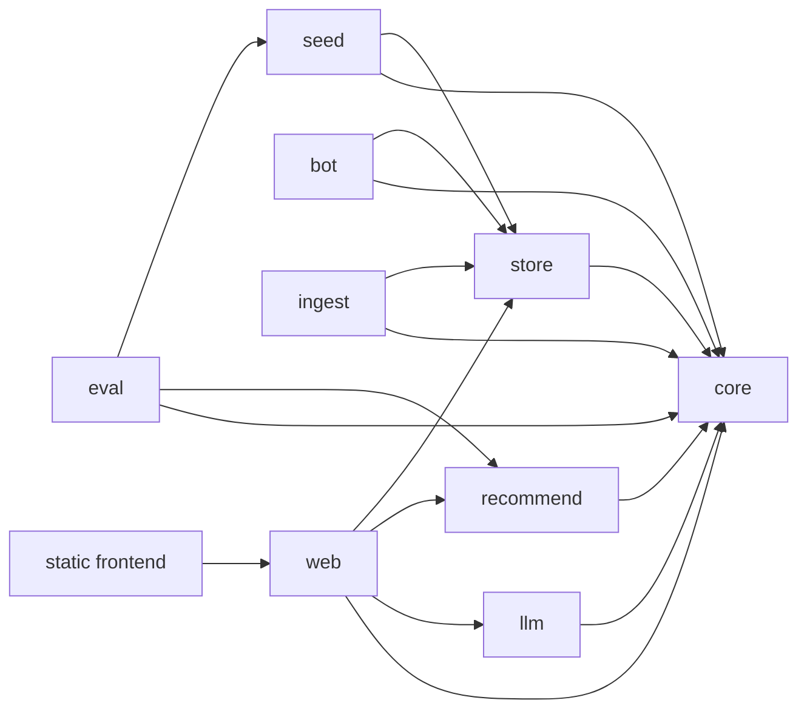

# campus-hangouts

> 64% of students feel very lonely, and every campus platform still assumes you'll show up alone.

campus-hangouts is a web app that puts KSU's official calendar events and student-hosted hangouts
in one "For you" feed. It explains why each recommendation is there, shows which friends are
going, and matches you with someone to go with. A Discord bot is one integration, not the core.

## Features

- **For you feed** with a plain-English reason on every card — and a finite one: "You're caught up" when there is nothing new.
- **Interested / Going / Going with ___**, with waitlist auto-promote when a spot opens up.
- **Buddy matching**: first a friend who's going, then a similar student you don't know yet.
- **Friend presence**: friends see friends only — never public attendee lists.
- **Anyone can host a hangout**, including natural-language hosting through a local LLM ("plan a Friday night movie at my place").
- **Crews** with a shared availability grid to find a time that works for everyone.
- **Privacy controlled by students**: attendance is private by default, and students decide what to share.

## Quickstart

```bash
cp .env.example .env
git config core.hooksPath .githooks
cargo run -p seed
cargo run -p ingest
cargo run -p web
```

Then open <http://127.0.0.1:3000> (add `?mock=1` to browse the static mock data with no backend running).

```bash
cargo run -p bot
```

The bot needs a `DISCORD_TOKEN` in `.env`.

## Architecture

| Crate | Owns | Notes |
|---|---|---|
| `core` | Domain types + pure time/availability logic | FROZEN after foundation |
| `api` | Wire DTOs for `docs/API.md` | FROZEN after foundation |
| `store` | sqlx + SQLite repository functions | Depends on `core` |
| `recommend` | Hybrid recommender (content, collaborative, social) | DB-free, unit-testable |
| `llm` | Local OpenAI-compatible client for natural-language hosting | Degrades gracefully when the server is down |
| `ingest` | KSU calendar import → official events | `calendar.kennesaw.edu/api/2/events` |
| `seed` | Deterministic demo data (users, crews, friendships, intent history) | |
| `eval` | Offline recommender evaluation | Baseline comparison, no live traffic |
| `web` | axum JSON API + serves `static/` | See `docs/API.md` |
| `bot` | poise Discord bot | One integration of the same backend |



## Recommender

A hybrid score combines weighted content, collaborative, and social signals (plus a popularity
term), so nothing depends on a single data source. Each component also produces a plain-English
reason, which is what gets shown on the card instead of a raw score. The whole pipeline is
evaluated offline against a popularity baseline in `docs/EVAL.md`.

## Development

```bash
cargo fmt --all
cargo clippy --workspace --all-targets -- -D warnings
cargo test --workspace
```

- Product spec: `docs/SPEC.md`
- API contract: `docs/API.md`
- Design decisions: `docs/DECISIONS.md`
- Work queue: `TASKS.md`

## Data & privacy

Demo users and their history are generated by `crates/seed` and are clearly labeled as demo
data. Official events come from the public KSU calendar API
(`calendar.kennesaw.edu/api/2/events`). Attendance is private to friends by default, and there
are no public attendee lists or follower counts anywhere in the product.

## License

MIT.
