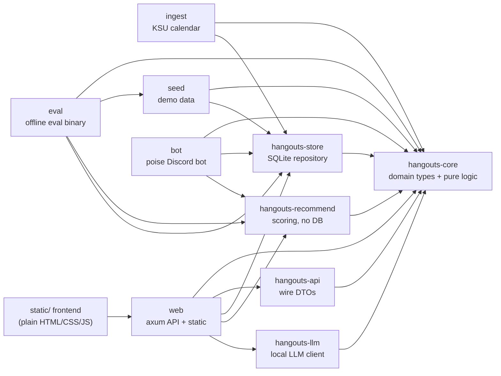
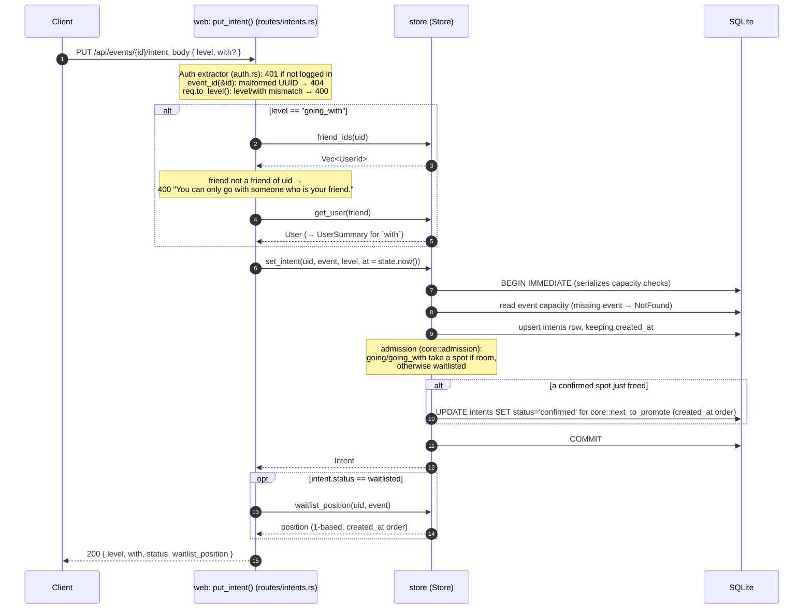
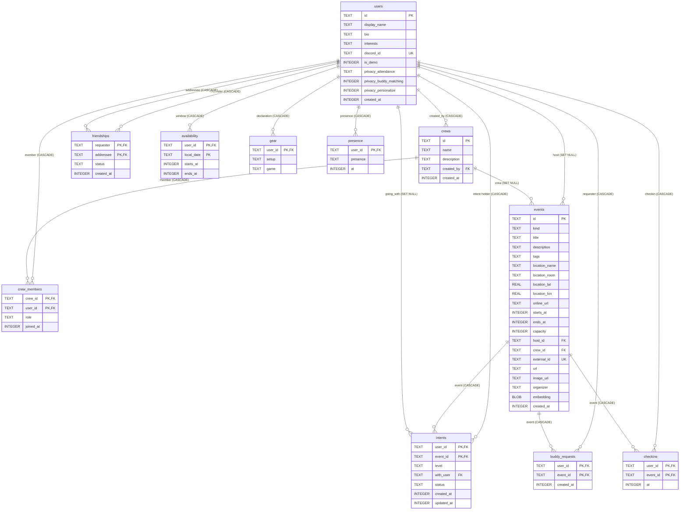

# Architecture

How the crates fit together, how the two main request paths flow through them,
what the data looks like, and where each record in [DECISIONS.md](DECISIONS.md)
is actually enforced in code.

## Crate dependency graph

Edges are the actual `[dependencies]` from each crate's `Cargo.toml` (arrow points
from depending crate to depended-on crate). `recommend` stays DB-free by design:
it scores from a `core::Snapshot`, so it is unit-testable without SQLite.
`recommend` also has an **optional** `fastembed` cargo feature; the default
build and all tests use the offline `HashEmbedder` instead.



- `crates/core` (`hangouts-core`) is the root: domain types plus pure logic
  (time parsing, availability overlap, admission, snapshot). No I/O, no async.
- `crates/api` holds the wire DTOs for [API.md](API.md); `static/mock/*.json`
  must round-trip through them.
- `crates/store` is the only workspace crate that touches SQLite. Every write
  takes an explicit `at: DateTime<Utc>`.
- `static/` is not a crate: `web` serves it, and `?mock=1` reads
  `static/mock/*.json` directly in the browser.

## Request flow: `GET /api/feed`

Source of truth: `crates/web/src/routes/feed.rs`, `crates/web/src/auth.rs`,
`crates/store/src/snapshot.rs`, `crates/recommend/src/feed.rs`.

```mermaid
sequenceDiagram
    autonumber
    participant C as Client (browser)
    participant W as web: feed() (routes/feed.rs)
    participant S as store (Store)
    participant R as recommend::feed()

    C->>W: GET /api/feed (Cookie: uid=…)
    Note over W: Auth extractor (auth.rs): read `uid` cookie,<br/>verify the user still exists in the store.<br/>Missing cookie, bad UUID, or unknown user →<br/>401 {"error":{"code":"unauthorized","message":"Please log in first."}}
    W->>S: load_snapshot()
    S-->>W: core::Snapshot (all tables, in memory)
    Note over W: now = state.now() (AppState clock)<br/>model = state.model.read() (RwLock)<br/>embedder = state.embedder
    W->>R: feed(&RecContext{ snapshot, user: uid, now, model, embedder }, &FeedConfig::default())
    Note over R: candidates = events starting in [now, now+7d),<br/>excluding events the viewer hosts<br/>score = 0.4·content + 0.25·collab + 0.25·social + 0.1·popular<br/>top 10, ties by start time then id
    R-->>W: Vec&lt;Recommendation&gt; { score, reasons, breakdown }
    Note over W: map each rec to api::FeedItem<br/>{ event: view::card(&snap, event, Some(uid)), score, reasons, breakdown }
    W-->>C: 200 { items: [...], caught_up: true }
```

`FeedConfig::default()` is horizon = 7 days, limit = 10, weights
content 0.4 / collaborative 0.25 / social 0.25 / popular 0.1
(`crates/recommend/src/feed.rs`). Content and collaborative components are
rescaled so the best candidate scores 1 before weighting. Reasons come from the
top-contributing components (at most 3; a second reason only if it added at
least 0.05).

## Request flow: `PUT /api/events/{id}/intent`

Source of truth: `crates/web/src/routes/intents.rs`,
`crates/store/src/intents.rs`, `crates/core/src/intent.rs`.



`DELETE /api/events/{id}/intent` takes the same id/auth checks, calls
`store.remove_intent(uid, event, at)` (idempotent) and returns 204.

## Data model

Source of truth: `migrations/0001_init.sql`. Timestamps are `INTEGER`
microseconds since the Unix epoch (UTC); ids are hyphenated UUID `TEXT`; tag
and interest lists are JSON arrays in `TEXT`.



Indexes: `events_starts_at (starts_at)` and `intents_event (event_id,
created_at)` — the latter exists so the waitlist position query and the
auto-promote scan are index-backed. `gear`'s composite primary key
`(user_id, setup, game)` is what makes gear declarations idempotent.

## Where each decision is enforced

One row per bullet in [DECISIONS.md](DECISIONS.md). "Enforced" means: the
code that would be broken if the decision were reversed.

### Carried over from the prototype

| Decision | Enforced in |
|---|---|
| **Presence is self-reported** (no privileged intents) | `crates/core/src/presence.rs` (the only representation of presence); set only through the bot's three buttons — `crates/bot/src/commands.rs` (`ButtonAction` dispatch → `set_presence`), stored by `Store::set_presence` (`crates/store/src/prototype.rs:101`) into the `presence` table. |
| **Buttons/menus over free text; individual replies ephemeral** | `crates/bot/src/commands.rs` (button/menu components, `.ephemeral(true)` on replies to individuals) and `crates/bot/src/helpers.rs` (ephemeral reply helpers, e.g. the `/foryou` ephemeral top-picks). |
| **All data in SQLite; DB file and tokens never committed** | Every crate persists through `crates/store` (the only SQLite consumer); `.gitignore` excludes `.env`, `*.db`, `*.db-*`, `*.sqlite*`; the repo ships `.githooks/pre-commit` (fmt + clippy gate) and `CLAUDE.md`'s "never commit" rule. |
| **Gear & games** (setup enum, blank title rejected, idempotent) | `crates/core/src/gear.rs` (`Setup`, `Gear`, trimmed case-insensitive parsing); `crates/store/src/prototype.rs:65` (`add_gear` upsert, idempotent); `crates/bot/src/commands.rs` (gear commands); `gear` table's composite PK `(user_id, setup, game)` in `migrations/0001_init.sql`. |
| **Availability:** one window per user per local date, replacing, default 00:00–23:59 | `crates/core/src/time.rs:140` (`local_window`, the 00:00–23:59 default); `Store::set_availability` (`crates/store/src/prototype.rs:16`), which replaces the row; the `availability` table's PK `(user_id, local_date)` in `migrations/0001_init.sql` makes "one per day" structural. |
| **Strict date/time parsing** | `crates/core/src/time.rs` (`parse_date`, `parse_time`, `parse_local_window` at line 162): reject trailing junk, impossible dates, out-of-range values, and name the bad input in the error; tests pin each rejection next to the code. |
| **Zero-padded dates** | `crates/core/src/time.rs`: `parse_date` accepts `2026-1-1` and `format_date` always emits `YYYY-MM-DD` (test `assert_eq!(format_date(d("2026-3-08")), "2026-03-08")`). |
| **DST-safe overnight rollover** | `crates/core/src/time.rs` (`local_window`/`resolve_local`): end-not-after-start moves to the next calendar day re-resolved in the zone; nonexistent local times shift forward, ambiguous ones take the earlier instant. Tests pin the 2026 transitions (Mar 8, Nov 1) at `crates/core/src/time.rs:386` onward. |

### Made in Phase 0

| Decision | Enforced in |
|---|---|
| **Frozen contracts for parallel lanes** | The frozen crates themselves: `crates/core`, `crates/api`, `docs/API.md`; frozen public signatures documented at the top of `crates/store/src/lib.rs`, `crates/recommend/src/lib.rs`, `crates/llm/src/lib.rs`; change requests route through `NEEDS.md`; the lane rules live in `CLAUDE.md` ("Rules for parallel lanes"). |
| **Wire types are Rust; mocks round-trip** | `crates/api/src/lib.rs` (DTOs) and `crates/api/tests/mocks.rs`, which parses every `static/mock/*.json` (20 files) through them — `cargo test -p api` fails if the mock JSON and the Rust wire types drift. |
| **Snapshot in, results out** | `crates/core/src/snapshot.rs` (`Snapshot`), `crates/store/src/snapshot.rs` (`load_snapshot`), `crates/recommend/src/lib.rs` (`RecContext`, `feed` — no DB access anywhere in the crate), and `crates/eval`, which scores on `crates/seed/src/lib.rs` `generate()` output without a database. |
| **Explicit `at` on every store write** | Every write function in `crates/store` takes `at: DateTime<Utc>` (e.g. `set_intent(user, event, level, at)` in `crates/store/src/intents.rs`, `Store::set_availability(..., at)`); stated as a contract in the `crates/store/src/lib.rs` header. |
| **Runtime `sqlx::query()` only** | All of `crates/store/src` uses `sqlx::query()`; the only `query!` mention in the crate is the doc comment explaining the avoidance (`crates/store/src/lib.rs:7`), so builds never need a `DATABASE_URL`. Migrations apply via `sqlx::migrate!("../../migrations")` in `Store::migrate`. |
| **Offline-first embeddings** | `crates/recommend/src/embed.rs` (`HashEmbedder`, `default_embedder`); `fastembed` is an optional cargo feature in `crates/recommend/Cargo.toml`; no test downloads a model (tests use `HashEmbedder`). |
| **Intent levels** (interested free; going/going-with take a spot; waitlist + auto-promote) | `crates/core/src/intent.rs` (`IntentLevel::uses_spot`, `admission` at line 147, `next_to_promote` at line 156); `crates/store/src/intents.rs` (capacity check + upsert + auto-promote inside `set_intent`); `migrations/0001_init.sql` (`intents.level` CHECK, `intents_event` index for the waitlist). |
| **Privacy defaults** | Column defaults in `migrations/0001_init.sql` (`users.privacy_attendance DEFAULT 'friends'` with only `'private'/'friends'` allowed, `privacy_buddy_matching DEFAULT 1`, `privacy_personalize DEFAULT 1`); `crates/core/src/user.rs:44` (`PrivacySettings`); `crates/web/src/routes/privacy.rs` (GET/PUT `/api/me/privacy` → `Store::set_privacy`); the "no attendee lists" rule is structural in `crates/web/src/view.rs` (no view type exposes them). |
| **Times stored Utc, shown `America/New_York`** | `crates/core/src/time.rs` (all parsing/display through chrono-tz's `America/New_York`; `DateTime<Utc>` as the stored type) and `crates/store/src/codec.rs` (`ts`/`ts_col` convert `DateTime<Utc>` ↔ epoch-microsecond `INTEGER`). |
| **Calendar export path** `/api/events/{id}/calendar.ics` | `crates/web/src/routes/calendar.rs` (`ics` handler, doc-comment `GET /api/events/{id}/calendar.ics`), wired in `crates/web/src/routes.rs`. |
